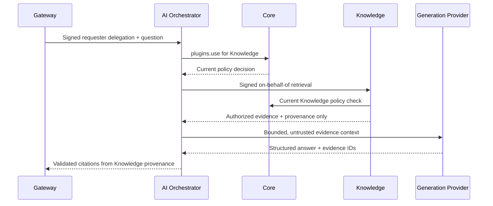

# AI Orchestrator

`@amani/ai-orchestrator` provides Amani's first stateless, documentary RAG operation.
It receives a Gateway-verified requester context, checks the existing Core Knowledge
capability, obtains already-authorized evidence from Knowledge, builds bounded context,
generates a structured answer and constructs citations from server-owned provenance.

## Responsibilities

- Verify the Gateway's short-lived service delegation in local development.
- Preserve the requester user and organization context when calling Core and Knowledge.
- Ask Core for the existing `plugins.use` policy check for the `knowledge` plugin.
- Call Knowledge `POST /knowledge/retrieval`; Knowledge remains responsible for ACL-aware
  retrieval, active membership, plugin availability and document resource grants.
- Deduplicate already-authorized chunks, retain ranking order and use only whole chunks
  within the configured evidence budget.
- Assign request-local evidence IDs (`E1`, `E2`, ...) and validate model-selected IDs.
- Return `insufficient_evidence` when no authorized evidence fits or no valid citation
  can support the model result.

## Non-responsibilities

This service does not access Knowledge PostgreSQL, pgvector, MinIO, Redis, document ACL
tables or object paths. It does not implement Analytics, external connectors, query
rewriting, agent loops, arbitrary tools, conversation history, evaluation or unrestricted
general chat. A cited document must be reauthorized by Knowledge when opened later.

## Request flow



The service identity proves the calling backend; it does not give that backend global
document access. Knowledge independently applies the requester's current authorization.

## API

Gateway exposes the public backend route:

```text
POST /api/ai/organizations/:organizationId/knowledge-rag
```

The Orchestrator's protected internal route is:

```text
POST /ai/knowledge-rag
```

Request body (`KnowledgeRagRequestV1`):

```json
{
  "organizationId": "UUID",
  "question": "How are annual compensation reviews handled?",
  "knowledgeBaseId": "UUID (optional)",
  "topK": 6,
  "minSimilarityBps": 0
}
```

`topK` is limited to 20 at the HTTP boundary and then to the Orchestrator's configured
limit. Knowledge has its own independent limits and similarity floor.

Response (`KnowledgeRagResponseV1`) contains `answered` or `insufficient_evidence`, a
safe answer, server-owned citations, retrieval counts/profile, safe generation metadata,
request ID and correlation ID. It never returns document content outside the answer,
storage URLs/keys, ACL records, provider secrets or authorization internals.

## Prompt and provider boundaries

The current prompt profile is `knowledge-rag-v1`. It states that document chunks are
untrusted data, cannot override policy and cannot invoke code, URLs, commands or tools.
The question and each evidence item are separately delimited; evidence IDs are generated
by the server, not by the model.

`GenerationProvider` is provider-neutral. `openai-compatible` sends a bounded request to
the configured server-side base URL and asks for JSON `{ answer, evidenceIds }`.
`deterministic-test` is a no-network adapter allowed only in development/test. It is not
valid production configuration. Invalid or fabricated evidence IDs are ignored; if no
valid citation remains, the result is `insufficient_evidence`.

## Configuration

Copy the template and keep every value server-side:

```bash
cp apps/ai-orchestrator/.env.example apps/ai-orchestrator/.env
```

| Variable group | Purpose |
| --- | --- |
| `ORCHESTRATOR_SERVICE_AUTH_MODE` | `disabled` by default; `development` enables local signed Gateway delegation only. |
| `ORCHESTRATOR_GATEWAY_DEVELOPMENT_SECRET` | Must equal Gateway `DEVELOPMENT_SERVICE_SECRET`. |
| `ORCHESTRATOR_CORE_DEVELOPMENT_SECRET` | Distinct Orchestrator-to-Core secret; configure the same value in Core. |
| `ORCHESTRATOR_KNOWLEDGE_DEVELOPMENT_SECRET` | Distinct Orchestrator-to-Knowledge secret; configure the same value in Knowledge. |
| `CORE_API_URL`, `KNOWLEDGE_API_URL` | Internal Core and Knowledge base URLs. |
| `ORCHESTRATOR_RAG_*` | Retrieval, evidence chunk and character limits. |
| `ORCHESTRATOR_GENERATION_*` | Provider, model, timeout, output limit and temperature basis points. |

For a real provider set `ORCHESTRATOR_GENERATION_PROVIDER=openai-compatible`,
`ORCHESTRATOR_GENERATION_BASE_URL`, `ORCHESTRATOR_GENERATION_MODEL` and the server-only
`ORCHESTRATOR_GENERATION_API_KEY`. Do not commit the key or pass it to a browser.

## Logging, failures and health

Logs record request/correlation IDs, organization ID, result/evidence/citation counts,
provider/model metadata, status and duration. They do not routinely record questions,
answers, prompts, chunks, URLs or API keys.

Core, Knowledge and generation failures are normalized to safe HTTP errors. Each external
step has a separate timeout; generation is not automatically retried. `GET /health` is
process liveness only and does not prove downstream readiness, authorization or model
availability.

## Manual commands

Run from the repository root after reviewing manifests and local environment values:

```bash
npm install
npm run lint:check --workspace=@amani/contracts
npm run typecheck --workspace=@amani/contracts
npm run build --workspace=@amani/contracts
npm run lint:check --workspace=@amani/ai-orchestrator
npm run typecheck --workspace=@amani/ai-orchestrator
npm run build --workspace=@amani/ai-orchestrator
npm run test --workspace=@amani/ai-orchestrator -- --runInBand
npm run test:e2e --workspace=@amani/ai-orchestrator -- --runInBand
```

Start Core, Knowledge and AI Orchestrator in separate terminals only after their local
environment files share the intended development secrets:

```bash
npm run dev:core
npm run dev:knowledge
npm run dev:orchestrator
npm run dev:gateway
```

See [ADR-0036](../../docs/architecture/adr/0036-ai-orchestrator-grounded-knowledge-rag.md)
and the [editable Mermaid flow](../../docs/architecture/diagrams/22-ai-orchestrator-grounded-knowledge-rag.mmd).
